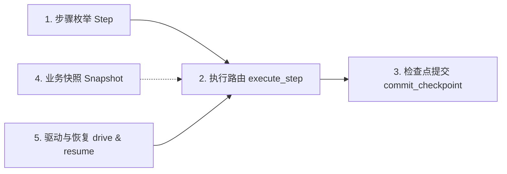

# 基于 pecs-graph 构建业务工作流开发指南

本文档介绍如何在智囊团（Roundtable）之外，为新业务（如：多维度代码审查、研报分析、风控审核、AI 会话编排等）快速接入 `pecs-graph` 工作流。

---

## 核心设计：五大要素骨架

构建一个健壮的 Agent / 异步工作流服务，通常只需声明并实现以下 5 个部分：



| 要素 | 职责 | 代码载体 |
| :--- | :--- | :--- |
| **1. 步骤枚举 (Step)** | 声明流程中的所有状态节点与转移携带的数据 | `enum MyStep` |
| **2. 业务快照 (Snapshot)** | 存放业务全量上下文、输入、子任务结果与最终产物 | `struct MySnapshot` |
| **3. 步骤执行 (step)** | 业务核心分发器：执行当前步骤，返回下一步位置 `Position<Step>` | `Workflow::step` 或 `execute_step` |
| **4. 检查点提交 (commit)**| 在每一步流转确认后保存游标（内存/数据库/Redis），处理暂停状态 | `Workflow::commit` 或 `commit_checkpoint` |
| **5. 生命周期驱动 (Service/drive)** | 异步 `spawn` 后台执行，封装 `create`、`drive`、`resume` 和 `cancel` | `MyService` |

> [!TIP]
> **API 风格选择**：`pecs-graph` 支持两种编写风格：
> 1. **Trait 契约风格（推荐）**：为业务服务实现 `pecs_graph::Workflow<Step>` trait，统一通过 `run_workflow` 驱动，契约清晰，易于 mock 测试与模块解耦。
> 2. **闭包注入风格**：直接向 `run` 传入 `execute_step` 和 `commit_checkpoint` 闭包，简单轻量。两者在底层执行语义完全一致。

---

## 快速接入模版：以「智能代码审查服务」为例

下面是一个完整的业务骨架示例：主 Agent 规划审查维度，并行执行子任务检查，若发现高危安全风险则暂停等待人工确认（Human-in-the-loop），确认后继续汇总生成报告。

### 1. 声明步骤状态机与业务快照

```rust
use pecs_graph::{
    Checkpoint, Position, RunLimits, RunOutcome, Workflow,
    run, run_batch, run_workflow,
};
use serde::{Deserialize, Serialize};
use std::{num::NonZeroUsize, sync::Arc, time::Duration};
use tokio::sync::{Mutex, Semaphore};
use tokio_util::sync::CancellationToken;

// 1. 显式步骤枚举：携带下一步需要的数据
// 建议 derive Clone, Debug, PartialEq 以及 Serialize, Deserialize（便于持久化和日志）
#[derive(Clone, Debug, PartialEq, Serialize, Deserialize)]
pub enum ReviewStep {
    /// 初始状态：准备规划
    Start,
    /// 规划阶段：分解审查任务
    Plan,
    /// 并发子任务阶段：携带待执行任务列表
    Inspect(Vec<ReviewTask>),
    /// 暂停等待人工介入：高危风险确认
    AwaitApproval { high_risks: Vec<String> },
    /// 汇总阶段：生成最终审查报告
    Synthesize,
}

#[derive(Clone, Debug, Serialize, Deserialize)]
pub struct ReviewTask {
    pub task_id: String,
    pub dimension: String, // e.g. "security", "performance", "style"
    pub prompt: String,
}

// 2. 业务快照：持久化上下文
#[derive(Clone, Debug, Default, Serialize, Deserialize)]
pub struct ReviewSnapshot {
    pub review_id: String,
    pub version: u64,
    pub status: String, // "running", "awaiting_approval", "completed", "failed"
    pub code_diff: String,
    pub task_results: Vec<(String, String)>, // (task_id, result)
    pub approved_by_user: bool,
    pub final_report: Option<String>,
}
```

---

### 2. 实现单步分发与执行逻辑 (`execute_step`)

`execute_step` 是流程的交通枢纽，每一步完成后返回：
- `Position::Ready(next_step)`：进入下一步；
- `Position::Paused(step)`：暂停当前流程，等待外部事件/用户输入唤醒；
- `Position::Completed`：流程正常完结。

```rust
pub struct ReviewService {
    // 内存存储或 DB Repository
    pub state: Arc<Mutex<ReviewState>>,
    pub permits: Arc<Semaphore>,
}

pub struct ReviewState {
    pub snapshot: ReviewSnapshot,
    pub checkpoint: Checkpoint<ReviewStep>,
    pub cancel: CancellationToken,
}

impl ReviewService {
    /// 单步业务执行路由
    async fn execute_step(
        &self,
        id: &str,
        step: ReviewStep,
    ) -> Result<Position<ReviewStep>, MyError> {
        match step {
            ReviewStep::Start => {
                println!("[{id}] 步骤 1: 初始化工作流...");
                Ok(Position::Ready(ReviewStep::Plan))
            }

            ReviewStep::Plan => {
                println!("[{id}] 步骤 2: 主模型规划审查维度...");
                // 模拟模型调用规划出的子任务
                let tasks = vec![
                    ReviewTask {
                        task_id: "sec".into(),
                        dimension: "security".into(),
                        prompt: "检查 SQL 注入与鉴权绕过".into(),
                    },
                    ReviewTask {
                        task_id: "perf".into(),
                        dimension: "performance".into(),
                        prompt: "检查内存分配与 O(N^2) 循环".into(),
                    },
                ];
                Ok(Position::Ready(ReviewStep::Inspect(tasks)))
            }

            ReviewStep::Inspect(tasks) => {
                println!("[{id}] 步骤 3: 并行执行子审查任务，批次大小: {}", tasks.len());
                let concurrency = NonZeroUsize::new(tasks.len()).unwrap_or(NonZeroUsize::MIN);
                
                // 使用 run_batch 实现有界并发与异常快速中断
                run_batch(&tasks, concurrency, |task| async move {
                    // 调用各个细分 Agent / LLM
                    let output = format!("{} 维度检查通过，无明显缺陷", task.dimension);
                    self.save_task_result(id, &task.task_id, output).await;
                    Ok::<_, MyError>(())
                }).await?;

                // 检查是否命中高危条件需要人工介入
                let has_high_risk = false; // 示例业务判断
                if has_high_risk {
                    Ok(Position::Paused(ReviewStep::AwaitApproval {
                        high_risks: vec!["发现疑似密钥硬编码".into()],
                    }))
                } else {
                    Ok(Position::Ready(ReviewStep::Synthesize))
                }
            }

            ReviewStep::AwaitApproval { .. } => {
                // 当通过 resume 唤醒后，直接进入汇总阶段
                println!("[{id}] 步骤 4: 人工已确认，继续流程...");
                Ok(Position::Ready(ReviewStep::Synthesize))
            }

            ReviewStep::Synthesize => {
                println!("[{id}] 步骤 5: 汇总所有分析并生成最终报告...");
                self.finalize_report(id).await?;
                Ok(Position::Completed)
            }
        }
    }

    async fn save_task_result(&self, _id: &str, task_id: &str, res: String) {
        let mut s = self.state.lock().await;
        s.snapshot.task_results.push((task_id.to_string(), res));
        s.snapshot.version += 1;
    }

    async fn finalize_report(&self, _id: &str) -> Result<(), MyError> {
        let mut s = self.state.lock().await;
        s.snapshot.status = "completed".into();
        s.snapshot.final_report = Some("代码质量评估：良好。".into());
        s.snapshot.version += 1;
        Ok(())
    }
}
```

---

### 3. 实现检查点提交 (`commit_checkpoint`)

执行器每次计算出下一个 `Position` 后，在执行下一步之前必须完成提交，保证故障恢复与状态一致：

```rust
impl ReviewService {
    async fn commit_checkpoint(
        &self,
        id: &str,
        checkpoint: Checkpoint<ReviewStep>,
    ) -> Result<(), MyError> {
        let mut s = self.state.lock().await;
        if s.cancel.is_cancelled() {
            return Err(MyError::Cancelled);
        }

        // 处理暂停点状态（Human-in-the-loop）
        if let Position::Paused(ReviewStep::AwaitApproval { high_risks }) = checkpoint.position() {
            s.snapshot.status = "awaiting_approval".into();
            println!("[{id}] 流程暂停等待人工介入: {high_risks:?}");
        }

        s.checkpoint = checkpoint;
        // 如果是持久化存储，在此处执行 db.update_run(...)
        Ok(())
    }
}
```

---

### 4. 驱动后台任务与人机交互恢复 (`drive & resume`)

`pecs-graph` 支持两种驱动方式：

#### 方式 A：实现 `Workflow` Trait 驱动（推荐）

为业务服务实现 `Workflow<Step>`，将步骤执行与检查点提交统一聚合：

```rust
impl Workflow<ReviewStep> for ReviewService {
    type Error = MyError;

    async fn step(&self, state: ReviewStep) -> Result<Position<ReviewStep>, Self::Error> {
        self.execute_step("default_run", state).await
    }

    async fn commit(&self, checkpoint: &Checkpoint<ReviewStep>) -> Result<(), Self::Error> {
        self.commit_checkpoint("default_run", checkpoint.clone()).await
    }
}
```

驱动调用只需传递 `&self`，签名清晰，避免裸闭包重复样板：

```rust
// 使用 run_workflow 驱动
let outcome = run_workflow(&mut checkpoint, limits, &cancel, self).await;
```

#### 方式 B：闭包组合驱动

当单例 Service 需要管理多租户/多会话、需要将 `id` 等上下文通过闭包捕获注入时，直接使用 `run`：

```rust
impl ReviewService {
    /// 核心主循环驱动入口
    pub async fn drive(&self, id: &str) -> Result<(), MyError> {
        let (mut checkpoint, cancel) = {
            let s = self.state.lock().await;
            (s.checkpoint.clone(), s.cancel.clone())
        };

        let limits = RunLimits {
            max_steps: NonZeroUsize::new(20).unwrap(), // 防死循环
            timeout: Duration::from_secs(60),          // 本次执行片段超时
        };

        let outcome = run(
            &mut checkpoint,
            limits,
            &cancel,
            |step| self.execute_step(id, step),
            |next| self.commit_checkpoint(id, next),
        )
        .await;

        match outcome {
            Ok(RunOutcome::Completed) => println!("[{id}] 工作流执行完毕"),
            Ok(RunOutcome::Paused) => println!("[{id}] 工作流已安全暂停"),
            Err(e) => eprintln!("[{id}] 工作流异常退出: {e:?}"),
        }
        Ok(())
    }

    /// 用户确认接口（Human-in-the-loop 唤醒）
    pub async fn approve_and_resume(self: &Arc<Self>, id: &str) -> Result<(), MyError> {
        {
            let mut s = self.state.lock().await;
            if s.snapshot.status != "awaiting_approval" {
                return Err(MyError::InvalidState);
            }
            s.snapshot.approved_by_user = true;
            s.snapshot.status = "running".into();
            // 关键：将 Paused 游标转为 Ready
            s.checkpoint = s.checkpoint.clone().resume();
        }

        // 后台重新调度驱动
        let svc = self.clone();
        let run_id = id.to_string();
        tokio::spawn(async move {
            let _ = svc.drive(&run_id).await;
        });

        Ok(())
    }
}

#[derive(Debug)]
pub enum MyError {
    Cancelled,
    InvalidState,
    ExecutionFailed(String),
}
```

---

## 常见设计模式与技巧

### 1. 循环与反思模式（Reflection / Self-Correction）
如果需要类似 “生成 $\to$ 验证 $\to$ 不合格重新修改” 的循环：
- 在 `ReviewStep` 中定义 `Refine { round: u8 }`；
- 在 `execute_step` 中判断 `round < max_round` 则返回 `Position::Ready(ReviewStep::Refine { round: round + 1 })`；
- 结合 `pecs_graph::RunLimits { max_steps, .. }`，框架层能保证不会出现死循环。

### 2. 外部持久化升级（跨进程 / 分布式恢复）
当前示例使用进程内内存保存检查点。若业务需要支持服务重启或横向扩展部署：
- 实现 `pecs_graph::Store` trait（提供 `get`, `put`, `compare_and_put`）；
- 使用 `pecs_graph::run_stored` 代替 `run`；
- 每次步骤提交将自动携带乐观锁版本号，天然支持分布式 Worker 竞争与抢占安全。

### 3. 取消与快速熔断
- 永远将 `CancellationToken` 传递给所有的子 I/O（如 HTTP 模型请求、外部工具调用）；
- `pecs-graph` 在每一步流转前后都会检查 token，并在取消时直接返回 `RunError::Cancelled`，清理挂起的并发 Future。

### 4. 动态规划与执行循环（Plan-Execute Loop）
在智能体决策工作流中（如 Roundtable 智囊团），步骤往往不是线性的，而是由规划模型动态主导：
- `Start -> Plan`：主持 Agent 读取当前上下文并输出下一步任务拆分；
- `Plan -> Analyze(tasks)`：并发执行子 Agent 分析；
- `Analyze -> Plan`：子任务执行完后**重新回到 Plan**，让规划模型感知子任务产物并决定是否需要补充交叉评审（Review）或直接汇总；
- `Plan -> Synthesize`：满足收敛条件后进入汇总完结。
通过 `RunLimits::max_steps` 可从容限制总轮数，无需担心模型死循环。

### 5. 部分失败容忍与优雅降级（Partial Failure Tolerance）
并发调用 LLM 或外部微服务时，常发生网络超时、偶发风控拦截或限流：
- **不要直接中断整个工作流**：在 `run_batch` 的闭包内部捕获单任务异常，将错误状态记录在快照的 `tasks` 中；
- **降级收敛**：在步骤流转时检查是否仍有可用结果（例如 `snapshot.tasks.iter().any(|t| t.result.is_some())`）；若有则继续流转到汇总步骤并在 Prompt 中注明部分失败，确保为终端用户产出降级后的最大价值，而非直接返回空白错误。

### 6. 批处理模式选型指南 (`run_batch` vs `run_stored_batch`)
| 维度 | `run_batch` | `run_stored_batch` |
|:---|:---|:---|
| **适用场景** | 内存快照型工作流、短时任务、结果合并写回 Snapshot | 跨进程/分布式任务、长时外部调用、强断点续跑 |
| **持久化粒度** | 外部统一在 Step/Snapshot 层面持久化 | 每个 Task 根据 `TaskKey(run_id, batch_id, task_id)` 独立持久化 |
| **幂等机制** | 外部业务层管理幂等过滤 | 框架自动查询 Store，已完成任务跳过执行直接重用结果 |
| **重试代价** | 若单步失败重试，需由业务代码过滤已完成项 | 传入相同的 `run_id` 和 `batch_id` 即可零浪费增量重跑 |

### 7. 检查点写入与副作用分离
`CheckpointWriter::write` 或 `commit_checkpoint` 的首要职责是保证游标原子提交：
- **纯粹性**：建议尽量只执行数据库更新或乐观锁版本递增；
- **状态发布**：WebSocket/SSE 实时广播、计时统计等业务副作用，建议放在 `commit` 成功后的外部事件通道中发布，避免在提交事务内包含可能阻塞或失败的网络副作用。

### 8. 错误类型别名与序列化最佳实践
- 当步骤无需持久化或 checkpoint 提交永远成功时，使用 `SimpleRunError<E>`（等价于 `RunError<E, Infallible>`）简化函数签名；
- 步骤枚举推荐派生 `#[derive(Clone, Debug, PartialEq, Serialize, Deserialize)]`。如果包含动态原因或字符串，优先使用 `String` 而非 `&'static str`，以确保能够跨进程序列化恢复。
